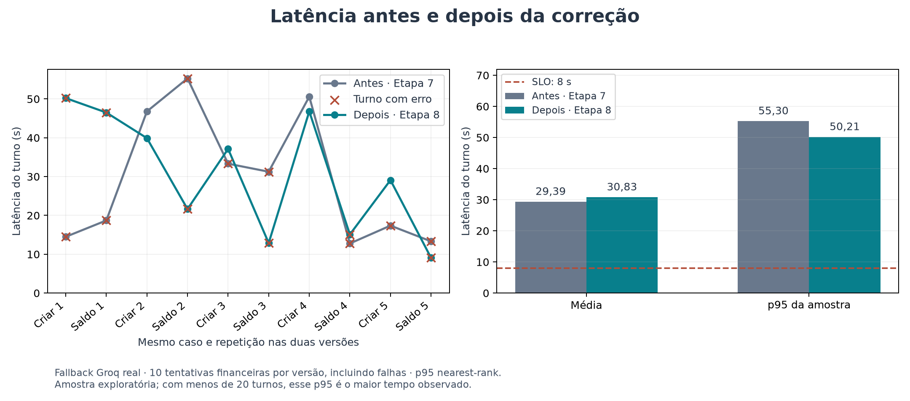
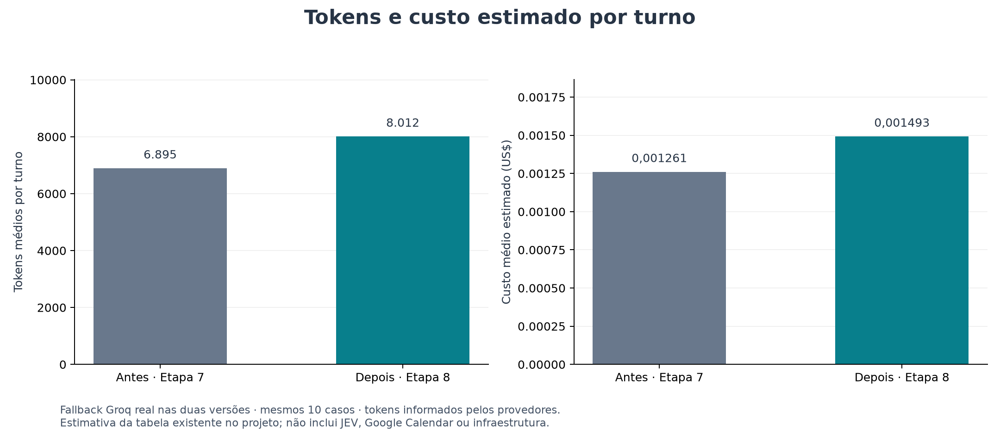
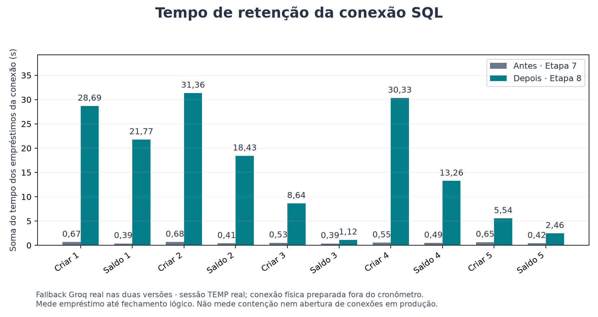
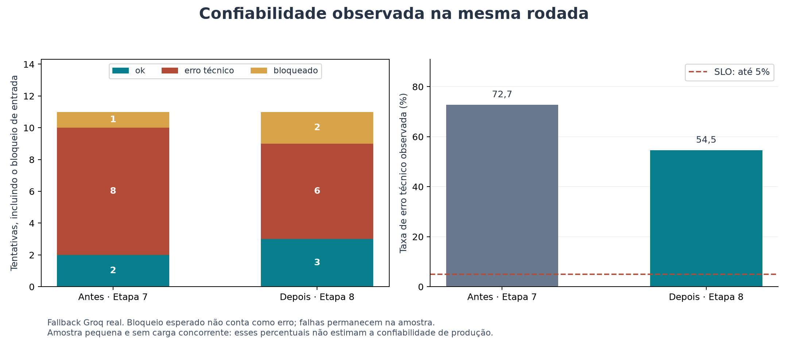
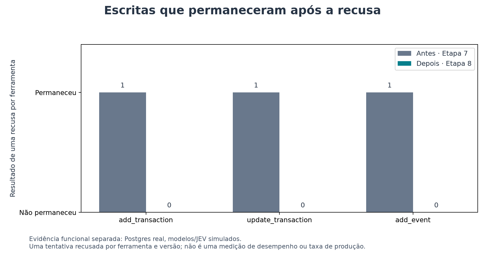

# Comparação de desempenho — Etapa 7 × Etapa 8

Leia primeiro a comparação entre **interceptar, adiar, transacionar e compensar**
em [`decisao_tecnica.md`](../../decisao_tecnica.md). Ela explica os mecanismos,
os efeitos esperados nas métricas e a escolha de transacionar. Este relatório
vem depois dessa análise e mede somente **linha de base × solução implementada**.
Não há medições das três alternativas descartadas; os gráficos não as classificam
por velocidade, custo ou taxa de erro.

Medição: 2026-10-29T10:58:47.502738-03:00. **Cenário: Fallback Groq real nas duas versões.**
O Gemini é tornado indisponível em memória, igualmente nos dois processos, para que o `with_fallbacks` existente use o Groq real. É uma rodada exploratória, com 10 turnos financeiros
por versão. Os números são medições salvas, não estimativas de tempos nem
simulações de respostas. Eles não demonstram que a correção causou uma
melhora ou piora de desempenho em produção.

## Versões e condições

- Antes: commit `1b6e64fbb6428245c37104285dc7350846ac915f`; código extraído do ZIP original, com SHA-256 verificado.
- Depois: código da aplicação entregue no commit `339e7fec71daad9066bd8603afd8b16b42a55e6b`.
- Mesmos pedidos e mesmos dados iniciais: uma despesa de R$ 10 por tentativa.
- Casos planejados: criar despesa e consultar saldo, 5 repetições de cada por versão.
- Ordem alternada AB, BA, AB, BA; sessão e processo novos a cada tentativa. O bloqueio de injeção é verificado separadamente em cada versão.
- Parâmetros, guardrails e rubrica do juiz preservados. Os prompts próprios de cada versão permanecem como entregues. O Gemini é tornado indisponível em memória, igualmente nos dois processos, para que o `with_fallbacks` existente use o Groq real. Nenhuma configuração da aplicação foi alterada.
- Modelos, JEV, Postgres e histórico Mongo reais. Tabelas TEMP e usuário exclusivo de teste. Nenhum envio ao Google Calendar.
- Imports, montagem das tabelas, conexão física SQL e limpeza ficam fora do cronômetro. A latência apresentada é a do monitor da Etapa 6, incluindo a gravação do histórico Mongo.
- Ambas as versões usam uma sessão SQL TEMP previamente aberta. Os empréstimos nessa sessão são serializados para permitir inspecionar as mesmas tabelas com segurança. Portanto, não medimos o custo real de abrir conexões nem a diferença de paralelismo entre ferramentas. A própria correção também limita as ferramentas do turno a uma por vez.
- A conexão fica restrita ao `search_path=pg_temp`; as escritas não alcançam as tabelas pessoais. A limpeza remove apenas o histórico do usuário de teste.

## Resultados financeiros comparáveis

| Métrica | Antes | Depois |
| --- | ---: | ---: |
| Latência média (ms) | 29.394 | 30.835 |
| p95 da amostra (ms) | 55.295 | 50.214 |
| Tokens médios por turno | 6.895 | 8.012 |
| Custo médio estimado por turno (US$) | 0,001261 | 0,001493 |
| Chamadas de modelo no conjunto | 36 | 42 |
| Chamadas de fallback no conjunto | 12 | 14 |
| Retenção média da conexão (ms) | 519 | 16.159 |

A média observada depois ficou 4,9% maior que antes. Essa diferença é descritiva desta amostra; não prova efeito causal
da correção. As respostas podem gerar quantidades diferentes de tokens e
chamadas, e o tempo do provedor oscila. Consulte também os status das tentativas.
As médias incluem turnos que terminaram em erro: uma falha pode ser rápida e
consumir menos tokens sem atender ao usuário. Por isso, custo por tentativa
não equivale a custo por operação concluída.

Apenas para leitura complementar, os turnos registrados como `ok` tiveram:

- Antes · Etapa 7: 2 turnos `ok`; média de 48,70 s e custo médio estimado de US$ 0,002255.
- Depois · Etapa 8: 3 turnos `ok`; média de 41,28 s e custo médio estimado de US$ 0,002253.

Esses subconjuntos têm tamanhos e resultados diferentes; não constituem uma
nova comparação controlada e não substituem a tabela com todas as tentativas.



O p95 usa o mesmo cálculo nearest-rank do monitor: ordenar e selecionar a
posição `ceil(0,95 × n)`. Com 10 amostras, ele coincide com o maior tempo
observado. Não é uma estimativa estável do p95 de produção. A linha de 8 s
é a meta do roteiro, não uma promessa de que ela foi atingida.



O custo usa os tokens efetivamente reportados e a tabela já existente no
monitor. É uma estimativa pelo preço cheio; não é o valor cobrado da conta.
JEV, Google Calendar, embeddings não instrumentados e infraestrutura ficam
fora dessa conta. Nenhuma tabela de preços nova foi pesquisada ou adicionada.



Antes, cada ferramenta libera sua conexão antes do juiz. Depois, a conexão
compartilhada aguarda a decisão e o commit/rollback. O gráfico mostra o tempo
dos empréstimos no teste; não mede espera por bloqueios entre usuários.
Essa espera mais longa pode afetar concorrência mesmo sem uma chamada extra
de modelo. Adiar o SQL seria uma alternativa para reduzir esse intervalo,
com os custos de plano, IDs e leituras pendentes descritos na decisão técnica.

## Erros e status

Status registrados em todas as tentativas, incluindo o bloqueio de entrada:

- Antes: `{"bloqueado": 1, "erro": 8, "ok": 2}`.
- Depois: `{"bloqueado": 2, "erro": 6, "ok": 3}`.

Taxa de erro registrada: **72,7% antes**
e **54,5% depois**. O denominador inclui
todas as tentativas da respectiva versão, inclusive o bloqueio esperado.



Nesta rodada foram registrados 14 retornos `BadRequestError`.
O detalhe das consultas de saldo foi:

- Antes · Etapa 7: 5 erros em 5 consultas de saldo.
- Depois · Etapa 8: 5 erros em 5 consultas de saldo.

Quando há falhas, isso impede considerar o fluxo estável com base nos resultados.
Não houve mudança da aplicação para esconder, repetir ou contornar essas falhas.

Uma consulta adicional de diagnóstico arquivada, fora da amostra, registrou
HTTP 400 do provedor, código `tool_use_failed`: o modelo tentou chamar uma
ferramenta chamada `JSON`, que não existe em `request.tools`. Esse resultado
está em `diagnostico_fallback.json`. Isso identifica o motivo daquela falha;
não prova que todas as falhas anteriores tiveram o mesmo conteúdo, pois
a coleta original guardou a classe do erro, sem a mensagem do provedor.

Recusas observadas na versão corrigida:

- `criar_r5`: `juiz:apoiada:abaixo_do_limiar noul=0.69`; commits: 0; estado preservado: True.

Os campos `antes`, `depois` e `commits` de cada tentativa permitem conferir
também se uma falha técnica deixou alguma escrita confirmada.

O bloqueio esperado do guardrail de entrada não conta como erro técnico.
Uma taxa de erro baixa nessa amostra pequena não comprova o SLO de 5%.
Os status são os registrados por cada versão, sem reescrever o monitor da
linha de base para melhorar a comparação. A versão corrigida distingue
explicitamente recusa normal de falha técnica do juiz/SQL.

## Garantia de escrita — evidência separada



Este gráfico usa `tests/evidencias_etapa8.json`: Postgres real, com modelos e
JEV simulados para controlar o veredito. Antes, uma recusa deixou a alteração
nas três ferramentas; depois, nenhuma das três recusas deixou alteração.
As aprovações também foram verificadas naquele arquivo: um commit por caso.
Esses casos demonstram correção funcional; não foram usados nas médias de
latência, tokens ou custo da rodada real.

## Todas as tentativas

| Versão | Caso | Latência (ms) | Status | Tokens | Custo estimado (US$) |
| --- | --- | ---: | --- | ---: | ---: |
| antes | bloqueio | 122 | bloqueado | 0 | 0,000000 |
| depois | bloqueio | 38 | bloqueado | 0 | 0,000000 |
| antes | criar_r1 | 14496 | erro | 6021 | 0,001147 |
| depois | criar_r1 | 50214 | erro | 6097 | 0,001173 |
| depois | saldo_r1 | 46500 | erro | 5669 | 0,000943 |
| antes | saldo_r1 | 18706 | erro | 5640 | 0,000945 |
| antes | criar_r2 | 46793 | ok | 11396 | 0,002248 |
| depois | criar_r2 | 39904 | ok | 11310 | 0,002205 |
| depois | saldo_r2 | 21643 | erro | 5682 | 0,000951 |
| antes | saldo_r2 | 55295 | erro | 5656 | 0,000955 |
| antes | criar_r3 | 33324 | erro | 5992 | 0,001130 |
| depois | criar_r3 | 37134 | ok | 11575 | 0,002334 |
| depois | saldo_r3 | 12885 | erro | 5687 | 0,000954 |
| antes | saldo_r3 | 31256 | erro | 5642 | 0,000947 |
| antes | criar_r4 | 50601 | ok | 11405 | 0,002262 |
| depois | criar_r4 | 46797 | ok | 11359 | 0,002218 |
| depois | saldo_r4 | 15102 | erro | 5674 | 0,000946 |
| antes | saldo_r4 | 12773 | erro | 5615 | 0,000930 |
| antes | criar_r5 | 17373 | erro | 5956 | 0,001108 |
| depois | criar_r5 | 29095 | bloqueado | 11394 | 0,002254 |
| depois | saldo_r5 | 9072 | erro | 5674 | 0,000946 |
| antes | saldo_r5 | 13324 | erro | 5628 | 0,000938 |

## Limites e reprodução

A execução é sequencial e tem até 5 repetições de dois pedidos.
Rede, fila e variação das respostas dos provedores continuam presentes.
Não é um teste de carga nem um isolamento causal da mudança. Para avaliar
concorrência e um p95 mais confiável, seria necessária uma amostra maior,
com cota disponível e conexões físicas representativas do uso real.
Não podemos atribuir uma diferença de tempo inteira ao commit/rollback.

`medicoes.json` guarda todas as tentativas, hashes das duas cópias, respostas,
chamadas e o método. `turnos.csv` permite conferir os cálculos em planilha;
`resumo.json` contém as agregações. Falhas não são apagadas. Uma interrupção
é registrada no JSON; pares incompletos não entram na tabela comparável.

```powershell
.venv\Scripts\python.exe tests/comparar_desempenho.py --cenario fallback --repeticoes 5
.venv\Scripts\python.exe tests/gerar_graficos_desempenho.py
```

O primeiro comando faz novas chamadas reais, consome cota e exige `.env`
local, bancos disponíveis e o ZIP original em `Downloads/Assessor.zip`
(ou `--zip-base CAMINHO`). O segundo apenas lê os dados salvos e gera as
figuras com Matplotlib, disponível no ambiente usado para esta análise.
Matplotlib não foi acrescentado às dependências da aplicação.

## Tentativa com a configuração original

O arquivo `medicoes_configuracao_original.json` preserva a primeira rodada.
A verificação curta inicial do Gemini funcionou; durante o primeiro par
financeiro, o provedor indicou limite de cota e o turno da versão corrigida
terminou com erro. A rodada foi interrompida para não continuar consumindo
chamadas nessa condição. Os tempos dela não foram misturados aos gráficos
do cenário com fallback, pois as condições dos dois lados eram diferentes.

O experimento com fallback permite comparar as duas versões nesse cenário
comum, mas não substitui uma rodada com Gemini disponível nos dois lados.
Para isso, use `--cenario original` com cota suficiente; preserve os resultados
anteriores antes de executar novamente, pois `medicoes.json` é o resultado atual.
